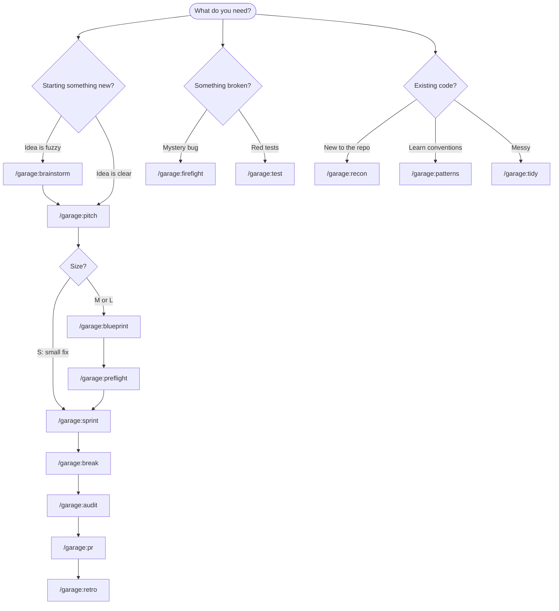

<div align="center">


# Claude Garage

### A startup crew for [Claude Code](https://code.claude.com).
**13 specialist agents · 20 slash commands · 2 output styles · interactive from the first keystroke.**

[](LICENSE)
[](#-install)
[](https://github.com/voyager67/claude-garage/stargazers)
[](CONTRIBUTING.md)
[](.github/workflows/validate.yml)

[**🌐 Interactive site**](https://voyager67.github.io/claude-garage/) · [Install](#-install) · [Which command?](#-which-command-should-i-use) · [The crew](#-the-crew) · [Commands](#-commands) · [Lanes](#-three-lanes-s--m--l) · [Customize](#-make-it-yours) · [FAQ](#-faq)



</div>

---

## 💡 The idea in 20 seconds

Most AI coding sessions fail the same way: a vague idea goes in, a pile of code comes out, and nobody asked whether it was the right thing to build.

**Garage fixes the order of operations.** It gives Claude Code the habits of a good small startup:

> **Pitch** it → **Blueprint** it → **Sprint** with parallel builders → **Break** it on purpose → **Audit** before merge → **PR** it → **Retro** so you never repeat a mistake.

Every step leaves a small Markdown file in `.garage/`. Close the terminal, come back tomorrow, run the same command, and it **resumes** where you stopped.

---

## 🚀 Install

**Requirements:** Claude Code with plugin support.

```bash
# inside Claude Code
/plugin marketplace add voyager67/claude-garage
/plugin install garage@claude-garage
```

Then, in any project:

```bash
/garage:guide                 # not sure where to start? It asks, then recommends
/garage:garage-init           # set up .garage/ and detect your test command
/garage:pitch "your idea"     # and you're rolling
```

<details>
<summary><b>⚡ One-line interactive installer (short command names, optional statusline)</b></summary>

```bash
curl -fsSL https://raw.githubusercontent.com/voyager67/claude-garage/main/install.sh | sh
```

The installer asks a few yes/no questions: user-wide or this project only, the Garage statusline, experimental Agent Teams. Your `settings.json` is backed up before any change.

Prefer to look first?

```bash
git clone https://github.com/voyager67/claude-garage.git
cd claude-garage
./scripts/install.sh              # interactive
./scripts/install.sh --yes        # defaults, no questions
./scripts/install.sh --uninstall  # remove everything it added
```

Standalone commands are un-prefixed: `/pitch`, `/sprint`, `/break`, and so on.

</details>

---

## 🧭 Which command should I use?

Don't memorize anything. Run **`/garage:guide`** and it asks you, or follow the map:



---

## 👥 The crew

Agents are organized by **what they do**, not by job titles. Each has a narrow brief, tight tools and a tiny context footprint.

| | Agent | Superpower | Can edit code? |
|:-:|---|---|:-:|
| 🧭 | **Chief** | Sizes work (S, M, L) and routes it to the right lane | No |
| 🔭 | **Scout** | Finds what already exists before anyone builds | No |
| 🎯 | **PM** | Shrinks scope, writes non-goals and kill criteria | No |
| 📐 | **Architect** | Blueprints with trade-offs and parallel-safe slices | No |
| 🎨 | **Pixel** | UX, states, copy and accessibility | No |
| 🏗️ | **Rigger** | CI/CD, containers, config and observability | Infra only |
| 🔨 | **Builder** | Ships one slice, tests first, smallest diff | **Yes** |
| 🧪 | **Tester** | Test strategy and blind acceptance scenarios | Tests only |
| 👹 | **Gremlin** | Breaks your code and proves it with a failing test | Tests only |
| 🛡️ | **Sentinel** | Traces untrusted input to dangerous sinks | No |
| 🧐 | **Critic** | Kind, specific review against the blueprint and rules | No |
| 🕵️ | **Detective** | Competing hypotheses, root cause before fix | No |
| ✍️ | **Scribe** | Docs and PR text verified against the code | Docs only |

Least privilege by design: reviewers are read-only and only Builder touches production code.

---

## 🛠️ Commands

<details open>
<summary><b>Setup and understand</b></summary>

| Command | What it does |
|---|---|
| `/garage:guide` | **Interactive.** Asks what you want, checks your workspace, recommends the command |
| `/garage:garage-init` | Create `.garage/`, detect the test command, offer house rules |
| `/garage:rules` | Interview-driven house rules (MUST, NEVER, SHOULD, ASK FIRST) enforced by other commands |
| `/garage:recon` | One-page map of an unfamiliar codebase |
| `/garage:patterns` | Discover real conventions and turn them into rules |
| `/garage:brainstorm` | Three distinct options (safe, ambitious, weird), then pick one |

</details>

<details open>
<summary><b>Plan and build</b></summary>

| Command | What it does |
|---|---|
| `/garage:pitch` | Idea → one-page pitch with non-goals, kill criteria and a size |
| `/garage:blueprint` | Pitch → technical plan in small slices (plus blind scenarios for size L) |
| `/garage:preflight` | Score the plan for complete, consistent, correct. Advisory, never blocking |
| `/garage:sprint` | Parallel builders run the plan in waves with drift checks |
| `/garage:test` | Run tests and **own** the result. No "pre-existing failure" excuses |
| `/garage:tidy` | Behavior-preserving cleanup, tests green after every step |

</details>

<details open>
<summary><b>Verify and ship</b></summary>

| Command | What it does |
|---|---|
| `/garage:break` | The Gremlin attacks your new code, with failing tests as proof |
| `/garage:audit` | Adaptive parallel review: security, quality, tests, plus specialists when the diff needs them |
| `/garage:pr` | Reviewer-friendly PR text. Never opens it without you |
| `/garage:launch` | Release checklist, changelog and notes for *your* project |
| `/garage:docs` | Generate or sync docs, every claim verified against the code |

</details>

<details open>
<summary><b>Maintain</b></summary>

| Command | What it does |
|---|---|
| `/garage:firefight` | Parallel investigators try to disprove each other. The survivor is the root cause |
| `/garage:retro` | Turn what happened into "when X, do Y" rules every command reads |
| `/garage:standup` | 10-line status from git and `.garage/` |

</details>

Full reference: [docs/commands.md](docs/commands.md) · [docs/agents.md](docs/agents.md)

---

## 🛣️ Three lanes: S · M · L

`/pitch` asks **Chief** to size the work, and `/sprint` detects the lane automatically from what exists on disk. You always get the right amount of ceremony, and you can override it.

| Size | For | Artifacts | How it runs |
|---|---|---|---|
| **S: Patch** | Fixes, tiny refactors, one acceptance check | `pitch.md` | Straight to build in 1 to 3 tasks |
| **M: Standard** | One feature, one or two components | `pitch.md` + `blueprint.md` | Slices in waves, up to 3 parallel builders, drift check after each wave |
| **L: Crew** | Multi-feature, real risk, parallel work | + `scenarios/` | Same as M, plus **blind scenarios**: Tester writes acceptance scenarios that Builders never see, and they run at the end of every wave |

```text
.garage/
├── config.md            # detected test command
├── rules.md             # your house rules
├── lessons.md           # compounding memory from /retro
├── recon.md · patterns.md
└── pitches/001-csv-export/
    ├── pitch.md         # why, who, size, non-goals, kill criteria
    ├── blueprint.md     # how, in slices, with rules check
    ├── scenarios/       # (size L) blind acceptance tests
    ├── sprint.md        # checkboxes + parked ideas
    └── break-report.md
```

---

## ⭐ Why Garage

- **Kill criteria, not just goals.** Every pitch says what evidence would make you stop.
- **Non-goals are mandatory.** Scope creep goes to a Parked list, not into the diff.
- **A gremlin on the team.** An agent whose only job is to break your feature, with a failing test for every finding.
- **Blind scenarios.** Builders can't game tests they have never seen.
- **Memory that compounds.** `/retro` writes rules to `lessons.md`; every command reads them.
- **Rules that enforce themselves.** Define them once with `/rules`; blueprint, sprint, preflight and audit check by rule id.
- **Adaptive review.** `/audit` pulls in concurrency, supply-chain, accessibility or infra specialists only when the diff needs them.
- **Adversarial debugging.** Tough bugs get several investigators who try to prove each other wrong.
- **Parallel, but safe.** Builders run side by side only on disjoint files, capped at three.
- **Interactive.** `/guide`, `/brainstorm`, `/rules` and `/pitch` ask short multiple-choice questions instead of making you write essays.
- **Resume anywhere.** State lives in plain Markdown, so a context reset costs nothing.
- **Never silent.** Commits, tags, pushes and PRs always need your explicit yes.

---

## 🎛️ Output styles and statusline

Switch personality anytime with `/output-style`:

| Style | Vibe | Best for |
|---|---|---|
| **Garage Rush** 🚀 | Demo-day energy, short punchy updates, proof over promises | Fast sprints |
| **Garage Mentor** 🎓 | Calm and educational, with 💡 insights on patterns and trade-offs | Learning a codebase |

The optional statusline (offered by the installer) shows what you need at a glance:

```text
📁 ~/c/p/my-app  ⎇ feat/csv-export*  🤖 Claude  🛠 pitch 001 4/6  🕐 32m  💰 $1.20
```

---

## 🧩 Make it yours

Everything is a Markdown file with a few lines of frontmatter.

**Add an agent** → `agents/perf-hawk.md`

```markdown
---
name: perf-hawk
description: Finds performance regressions. Use after /garage:sprint on hot paths.
tools: Read, Grep, Glob, Bash
---
You are Perf Hawk. Profile before you opine...
```

**Add a command** → `skills/my-command/SKILL.md`

```markdown
---
name: my-command
description: What it does and when Claude should use it.
argument-hint: "<what to pass>"
---
# /my-command
1. Step one...
```

Then run `python3 scripts/build-docs.py` (regenerates the reference docs and the site) and `python3 scripts/validate.py`.

---

## ❓ FAQ

**Does Garage replace Claude Code's own planning?** No. It adds structure around it: a pitch, a plan, a test of that plan, and a memory.

**Is it only for big projects?** No. Size **S** is a one-page pitch and a quick build. Use `/garage:firefight` and `/garage:test` on tiny things.

**Will it commit or push without asking?** Never. Commits are opt-in per sprint, and tags, pushes and PRs always need confirmation.

**Why are commands prefixed `garage:`?** Claude Code namespaces plugin commands. The standalone installer gives you short names.

**Can my team share it?** Yes. Commit `.garage/` and the rules and lessons become shared team memory.

**Is it safe to install?** It's plain Markdown plus three small scripts you can read in a minute. See [SECURITY.md](SECURITY.md).

---

## 🗺️ Roadmap

- [ ] `/garage:estimate`: slice-based time estimates from your own git history
- [ ] `/garage:deps`: dependency health check
- [ ] Language-specific Gremlin attack packs
- [ ] Community agent gallery

Have an idea? [Open an issue](../../issues/new/choose) or start a [discussion](../../discussions).

---

## 🙏 Acknowledgements

Claude Garage adapts and extends ideas from [The Agentic Startup](https://github.com/rsmdt/the-startup) by Rudolf Schmidt (MIT), including spec-first workflows, complexity tiers, drift detection, code ownership, adaptive review, adversarial debugging and output styles. See [NOTICE.md](NOTICE.md). Everything else (the pitch-to-retro lifecycle, kill criteria, blind scenarios, the Gremlin, `lessons.md` memory, rules, the interactive guide and site) is new here.

## 🤝 Contributing

PRs are very welcome. Read [CONTRIBUTING.md](CONTRIBUTING.md), keep agents narrow and commands short, and run `python3 scripts/validate.py` first.

## 📄 License

[MIT](LICENSE) © 2026 Your Name. Free to use, modify and ship.

<div align="center">

**If Garage saved you an afternoon, a ⭐ helps other builders find it.**

*Built in a garage. Shipped from a terminal.*

</div>
